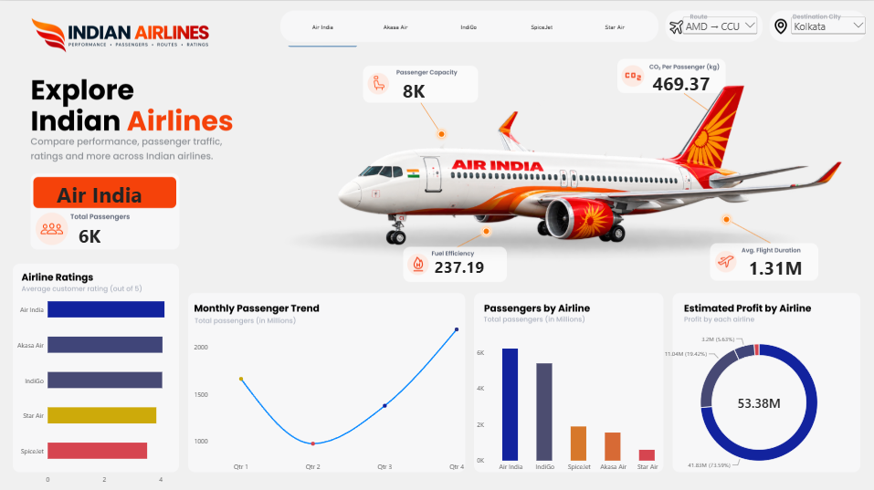

# ✈️ Indian Airlines Power BI Dashboard

An interactive Power BI dashboard to compare Indian airlines on passenger traffic, customer ratings, fuel efficiency, CO₂ emissions, flight duration and estimated profit.

## 📌 Overview
This project analyses data for five airlines: **Air India, Akasa Air, IndiGo, SpiceJet and Star Air**. Users can switch between airlines and filter by route and destination city to see how each carrier performs.

## 📊 Dashboard Features
- **Airline selector:** switch the whole report between airlines
- **Route and Destination City slicers:** drill into specific routes (e.g. AMD → CCU, Kolkata)
- **KPI callouts:** Total Passengers, Passenger Capacity, CO₂ per Passenger (kg), Fuel Efficiency, Avg. Flight Duration
- **Airline Ratings:** average customer rating out of 5
- **Monthly Passenger Trend:** passenger movement across quarters
- **Passengers by Airline:** total passengers compared across airlines
- **Estimated Profit by Airline:** profit share by airline (donut chart)

## 🛠️ Tools Used
- Power BI Desktop
- DAX (measures and calculations)
- Power Query (data cleaning)
- Microsoft Excel (data source)

## 📁 Repository Contents
| File / Folder | Description |
|---|---|
| `Airline_analysis.pbix` | Power BI report file |
| `Airline_analysis.pdf` | PDF export of the dashboard |
| `Indian_Airlines_Dataset.xlsx` | Source dataset |
| `Templates/` | Dashboard background templates, Power BI template file and preview image |
| `Templates/dashboard-preview.png` | Dashboard screenshot used in this README |

## 🚀 How to Use
1. Download `Airline_analysis.pbix`.
2. Open it in **Power BI Desktop**.
3. If the data does not load, go to **Home → Transform data → Data source settings**, click **Change Source**, and select `Indian_Airlines_Dataset.xlsx`.
4. Use the airline tabs, Route and Destination City slicers to explore the dashboard.

To build your own version, open the template in the `Templates` folder and connect it to your own dataset.

## 💡 Key Insights
- Air India and IndiGo carry the largest passenger volumes, well ahead of SpiceJet, Akasa Air and Star Air.
- Air India has the highest average customer rating, while SpiceJet has the lowest.
- Estimated profit is heavily concentrated: one airline accounts for about 74% of the total 53.38M.
- Monthly passenger trend dips in Quarter 2 and recovers strongly through Quarter 4.

## 👤 Author
**Aryan Bhardwaj**
[GitHub](https://github.com/aryanbhardwaj-tech)
